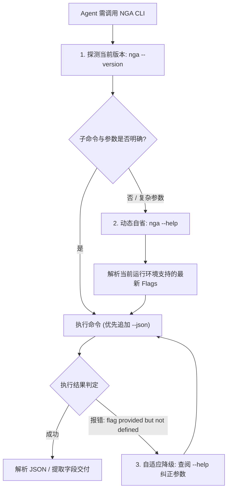

# NGA CLI 通用命令用法与 Agent 动态交互规范

本 Skill 为 **AI Agent（如 Multica、Codex 等）提供调用 `nga` 命令行工具的通用标准规范**。为解决命令行工具随版本迭代带来的“命令与参数过时（Skill 腐化）”痛点，本规范深度融入了**动态自省（Dynamic Self-Inspection）、结构化数据优先与自适应降级机制**，确保在项目功能持续更新演进后依然保持长效保鲜度。

---

## 1. 核心原则：持续保鲜度设计 (Stay Fresh Contract)

> [!IMPORTANT]
> **动态自省优先于静态记忆**：
> 随着 `nga-cli` 版本的演进，可能会增加新的子命令或扩展现有参数。Agent 在遇到不确定的参数、执行报错或调用高阶功能时，**严禁盲目臆测参数**，必须通过动态自省命令实时探测当前二进制的真实能力。

### 1.1 三步动态自省机制



1. **版本与环境探测**：
   ```bash
   nga --version
   ```
2. **动态自省帮助系统**：
   ```bash
   # 查看根命令与全局可用参数
   nga --help

   # 查看具体子命令的实时参数定义与默认值
   nga <command> --help
   # 示例:
   nga read --help
   nga tail --help
   nga reply --help
   nga post --help
   nga profile --help
   nga doctor --help
   nga upgrade --help
   ```
3. **结构化 JSON 优先原则**：
   - 在任何 Agent 驱动或自动化管道中，**优先追加全局 `--json` 参数**。
   - CLI 的终端排版字符（颜色、边框、卡片）可能会随版本优化，但 `--json` 输出模型具备向后兼容性与机器可解析性，能有效阻断界面排版变更对 Agent 解析造成的干扰。

---

## 2. 命令全景与参数矩阵

### 2.1 全局参数 (Global Flags)

所有子命令均可挂载以下全局参数：

| 参数 | 类型 | 默认值 | 作用与 Agent 最佳实践 |
| :--- | :--- | :--- | :--- |
| `--json` | bool | `false` | **Agent 必须优先开启**：输出结构化 JSON，便于 `jq` 解析与自动化处理。 |
| `--profile <name>` | string | `""` | 指定调用的账号凭据 Profile（可在不同 Cookie 与独立代理间切换）。 |
| `--proxy <url>` | string | `""` | 临时覆盖代理设置，支持 `http://` 与 `socks5://`。 |
| `--no-cache` | bool | `false` | 禁用本地 SQLite 缓存，强制穿透向 NGA 服务器发起网络请求。 |
| `--cache-dir <dir>` | string | `~/.cache/nga` | 自定义本地缓存目录。 |
| `--rate-limit <ms>` | int | `1500` | 最小请求间隔毫秒数，防止高频触发论坛 WAF 封锁。 |
| `--no-color` | bool | `false` | 禁用 ANSI 彩色字符。 |

---

### 2.2 核心子命令与实操指南

#### 1. 网络与防风控健康诊断 (`doctor`)
在首次执行批量读取、监控或发帖前，运行诊断检查网络与 WAF 状态：
```bash
# 结构化诊断探测
nga doctor --json

# 通过指定代理进行探测
nga doctor --proxy socks5://127.0.0.1:7890 --json
```
- **核心返回字段**：
  - `probe_success`: 网络连通性是否正常；
  - `waf_challenged`: 是否触发了 NGA WAF 验证（如 `ERROR:15`）；
  - `egress_ip`: 当前出口 IP。

#### 2. 读取帖子内容 (`read`)
按页码读取指定帖子的内容，自动利用本地不可变历史页缓存：
```bash
# 读取 TID 47288722 第 1 页 (JSON 格式)
nga read 47288722 -p 1 --json

# 仅查看楼主发言
nga read 47288722 -p 1 --author --json

# 过滤指定 UID (仅查看特定用户或剔除黑名单)
nga read 47288722 -p 1 --include-uid 60613851 --json
nga read 47288722 -p 1 --filter-uid 123456,876543 --json

# 强制跳过本地缓存刷新本页
nga read 47288722 -p 1 --refresh --json
```

#### 3. 尾部查看与流式监听 (`tail`)
利用尾页数学直算算法，避免翻页全量请求：
```bash
# 查看最后 10 楼数据包 (自动直算末页，单次请求完成)
nga tail 47288722 -n 10 --json

# 仅提取最后 5 楼中楼主的回复
nga tail 47288722 -n 5 --author --json

# 流式持续监听新回复 (-f，内置 ±500ms 随机抖动与最高 10s 退避)
nga tail 47288722 -f --compact
```
> [!TIP]
> 针对超大帖子（10万+ 楼），查看末尾最新发言**必须使用 `nga tail` 而不是循环调用 `nga read`**。关于大规模帖子的深度监控规范，详见专门的 `nga-thread-monitor` Skill。

#### 4. 回复帖子 (`reply`)
向指定 TID 发表回复，支持引用指定楼层与防重校验：
```bash
# 文本直接回复
nga reply 47288722 -m "感谢分享！已收录。"

# 引用指定楼层（自动提取该楼内容并组装标准 [quote] BBCode）
nga reply 47288722 --quote 0 -m "完全赞同主贴观点。"

# 从文件导入长文本正文 (Agent 推荐用法，规避 Shell 引号转义异常)
nga reply 47288722 -f ./reply_content.md

# 使用指定账号 Profile 发送
nga reply 47288722 -m "测试回复" --profile homelab

# 强制发送 (跳过本地 SQLite 30 秒重复提交检查)
nga reply 47288722 -m "加急提交" --force
```

#### 5. 发布新主题 (`post`)
向指定板块 FID 发布全新主题帖：
```bash
# 发布新帖 (如 FID 441)
nga post 441 -t "【前瞻】NGA CLI 自动化集成报告" -m "由 AI Agent 自动生成并发布的测试报告。"

# 从文件导入长文并发布
nga post 441 -t "【报告】系统巡检结果" -f ./report.md --profile default
```

#### 6. 多账号 Profile 凭证管理 (`profile`)
管理本地多账号 Cookie 与专属代理：
```bash
# 查看所有已配置 Profile
nga profile list

# 添加或更新 Profile
nga profile set default --uid 12345678 --cid "your_cid_token"

# 为 Profile 绑定专属 SOCKS5 代理
nga profile set worker1 --uid 87654321 --cid "token_2" --proxy "socks5://127.0.0.1:7890"

# 切换当前默认活跃 Profile
nga profile use worker1

# 删除指定 Profile
nga profile remove alt
```

#### 7. 基础配置管理 (`config`)
```bash
# 查看当前全部生效配置
nga config show

# 设置持久化配置项 (例如默认代理或速率)
nga config set proxy "http://127.0.0.1:7890"
nga config set rate_limit 2000
```

#### 8. 客户端自更新 (`upgrade`)
从 GitHub Release 检测新版本并完成自更新，Agent 可安全用于版本保鲜巡检：
```bash
# 仅检测是否存在新版本 (不下载、不替换二进制)
nga upgrade --check --json

# 执行自更新 (下载当前平台资产 -> SHA256 校验 -> 原子替换)
nga upgrade --json

# 安装指定历史版本 / 降级 (需显式 --force)
nga upgrade --version v0.1.0 --force --json

# 镜像站、GitHub Enterprise 或自定义仓库
nga upgrade --repo owner/nga-cli --api-base https://gitea.example.com/api/v1 --json
```
- **核心返回字段**：
  - `update_available`: 是否存在可比当前版本更新的 Release；
  - `applied`: 本次是否已完成二进制替换（`--check` 恒为 `false`）；
  - `asset_name` / `asset_size`: 命中当前系统架构的预编译资产及其下载字节数；
  - `checksum` + `checksum_verified`: SHA256 摘要与校验结论（缺失 `checksums.txt` 时校验失败并中止，除非追加 `--no-checksum`）；
  - `target_path`: 被替换的二进制绝对路径。
- **Agent 调度建议**：巡检只使用 `--check`；`applied == true` 后需重新读取 `nga --version` 再继续调度，因为磁盘上的二进制已被替换为新的可执行文件。

---

## 3. Agent 管道集成最佳实践

### 3.1 文本内容传递规范 (避免 Shell 转义陷阱)

Agent 在处理含有多行排版、特殊符号（如引号、`$`, `\`, `` ` ``）的回复或发帖内容时，**切勿使用 `-m "..."` 拼接复杂 Shell 字符串**，应遵循**文件输入规范**：
```bash
# 1. 使用 Agent 工具在本地工作目录安全写入 UTF-8 内容文件
# 2. 传参使用 -f 指定文件
nga reply 47288722 -f ./safe_reply.txt --json
```

### 3.2 搭配 `jq` 进行结构化信息提取

```bash
# 提取主贴标题与总楼层
nga read 47288722 -p 1 --json | jq '{title: .title, total_posts: .total_posts, author: .author_name}'

# 提取最新一楼的作者名与文本
nga tail 47288722 -n 1 --json | jq -r '.posts[0] | "\(.author_name): \(.content)"'

# 检查发帖/回复响应结果
nga reply 47288722 -m "自动打卡" --json | jq -r '.message'
```

---

## 4. 异常处理与自愈指南 (Self-Healing & Troubleshooting)

| 报错或异常状态 | 根本原因 | Agent 自愈动作 |
| :--- | :--- | :--- |
| `unknown flag: --xxx` | CLI 版本差异或参数名更新 | **立即执行 `nga <cmd> --help`**，从输出中动态读取最新的 Flags 列表重新调度。 |
| `ERROR:15` | WAF 识别出非标准客户端 | 检查是否传递了自定义桌面端 `--user-agent`；去掉自定义 UA，使用 CLI 默认内置移动端 UA。 |
| `HTTP 403 / 503` | 触发 IP 访问频控 | 检查 `doctor` 诊断；在命令中挂载 `--rate-limit 3000` 或配置代理 `--proxy`。 |
| `duplicate submission prevented` | 触发本地 30 秒相同内容防刷保护 | 如确实需要重复发送相同内容，追加 `--force` 参数绕过本地防重。 |
| `GitHub API 限流 (HTTP 403 / 429)` | Release 检测接口匿名调用配额耗尽 | 配置 `GITHUB_TOKEN` 环境变量，或挂载 `--proxy` 更换出口 IP 后重试。 |
| `未包含当前平台 (os/arch) 的资产` | 该 Release 未构建目标平台产物 | 从报错列出的可用资产中挑选匹配项，或降级到最近一个包含该平台产物的版本 `--version <tag> --force`。 |
| `SHA256 校验失败` | 下载内容被截断或遭中间人篡改 | 二进制保持原样未替换；重试 `nga upgrade`，持续失败时向仓库维护者报告。 |
| `cookie credentials required` | 访问受限板块或发帖需要登录 | 检查 `nga profile list`，若无凭证提醒用户配置 UID 与 CID。 |

---

## 5. 规范版本记录

- **v1.1.0 (2026-11-10)**：新增 `upgrade` 自更新命令说明（GitHub Release 检测、SHA256 校验、原子替换与 Agent 巡检建议）。
- **v1.0.0 (2026-11-08)**：初始发布通用命令用法规范，确立动态自省机制、全局参数矩阵、子命令最佳实践与 Agent 保鲜度契约。
