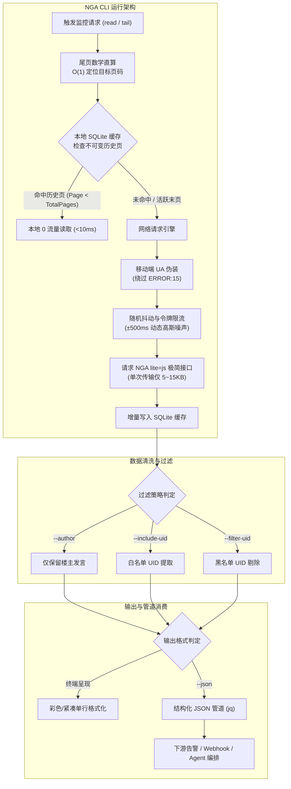
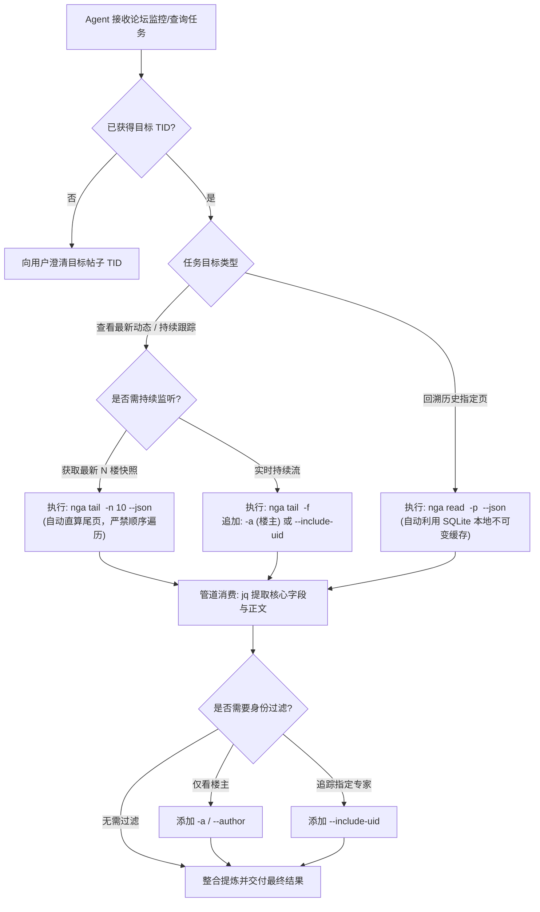

# NGA 帖子监控与特定用户回复追踪最佳实践与规范

本规范既作为**人类开发者/运维工程师的运维实操指南**，又作为**AI Agent 自动化调度与管道集成的标准 Skill 规范**。涵盖超大体量帖子极速直算、极简网络流量控制、特定人员与楼主过滤、防风控流式监听以及下游自动化管道对接等全流程最佳实践。

---

## 1. 概述与架构全景

### 1.1 核心痛点与工程挑战

艾泽拉斯国家地理论坛 (NGA) 作为国内高活跃度游戏与综合讨论社区，具备鲜明的平台特性与反爬挑战：
1. **超级热帖体量庞大**：热门讨论帖楼层极易突破 10 万+（如 TID `47288722`），按 20 楼/页计算达 5000+ 页。传统顺序翻页遍历不仅耗时数十分钟，更会触发 WAF 封锁。
2. **严格的 WAF 行为风控**：NGA 部署了高敏感度的请求频率监控与防爬挑战（如针对 PC 浏览器的 `ERROR:15` JS 挑战代码，以及针对固定频率轮询机器人的 IP 封锁）。
3. **网络流量开销巨大**：网页端包含大量复杂 DOM、表情包、用户头像与统计 JS，单页完整请求可达 2~5 MB；全量监控将造成极大流量浪费。

### 1.2 整体解决方案架构

NGA CLI 采用**极简数据协议 + 本地不可变缓存 + 尾页数学直算 + 随机抖动退避**的综合架构，实现极致轻量化与高可用监控。



---

## 2. 核心规范一：超大体量帖子极速直算规范

> [!IMPORTANT]
> **严禁全量顺序遍历**：面对 10万+ 楼（如 TID `47288722`）超大帖时，绝对禁止采用从第 1 页顺序请求至末页的暴力爬取方式。必须基于帖子元数据总回复数直接计算目标尾页精准拉取。

### 2.1 直算数学原理

NGA 标准板块每页固定包含 **20 楼**（Page 1 包含 0~19 楼，Page 2 包含 20~39 楼，以此类推）。
设帖子总回复数为 $T$（Total Posts），欲查看最后 $n$ 楼：

1. **探测元数据**：发起 1 次极简 Page 1 请求，获取最新的 `total_posts` 与 `total_pages`（耗时 ~100ms，传输 ~8KB）。
2. **计算目标起始楼层**：
   $$S = \max(0, T - n)$$
3. **计算目标页码区间**：
   $$\text{StartPage} = \lfloor S / 20 \rfloor + 1$$
   $$\text{EndPage} = \text{TotalPages} = \lceil T / 20 \rceil$$
4. **尾页精准请求**：仅请求 $[\text{StartPage}, \text{EndPage}]$ 范围内的页面。

**性能对比**：
- **顺序遍历**：请求次数 $= 5000+$ 次，网络流量 $\approx 50\text{MB}\sim 250\text{MB}$，耗时 $> 10$ 分钟（必封 IP）。
- **极速直算**：请求次数 $= 1 \sim 2$ 次，网络流量 $\approx 10\text{KB}\sim 25\text{KB}$，耗时 $< 300\text{ms}$，网络消耗降低 **99.9%**。

### 2.2 命令行最佳实践

```bash
# 查看超大帖最后 10 楼 (默认)
nga tail 47288722

# 查看超大帖最后 20 楼并开启紧凑单行排版 (适合移动端或紧凑终端)
nga tail 47288722 -n 20 --compact

# 查看超大帖最后 5 楼并输出结构化 JSON 供后续提取
nga tail 47288722 -n 5 --json
```

---

## 3. 核心规范二：极简流量与本地缓存规范

### 3.1 极简流量三大支柱 (Minimal Traffic Protocol)

1. **全局接口轻量化**：强制调用 NGA 官方极简移动端接口 `read.php?lite=js`，剥离 Web 端复杂的 HTML DOM、广告与样式脚本。
2. **零静态媒体加载**：纯命令行文本交互，彻底禁用论坛头像、签名图、主题表情贴纸、CSS、JS 等静态资源加载，单请求网络开销压缩至 **5~15 KB**。
3. **传输层压缩**：原生支持并默认启用 HTTP `Accept-Encoding: gzip, deflate, br`，利用 Brotli/Gzip 高效压缩论坛文本。

### 3.2 嵌入式 SQLite 增量不可变缓存

NGA 帖子具有天然的数据特征：**历史封存楼层不可篡改（Immutable），仅最新活跃末页存在新增回复**。NGA CLI 内置无 CGO 纯 Go SQLite 驱动，实现智能分级缓存：

| 页面类型 | 判定规则 | 缓存策略 | 读取耗时 | 流量消耗 |
| :--- | :--- | :--- | :--- | :--- |
| **不可变历史页** | $\text{Page} < \text{TotalPages}$ | 写入 SQLite，24小时长效持久化 | **< 10ms** | **0 KB (纯本地读)** |
| **动态活跃末页** | $\text{Page} == \text{TotalPages}$ | 实时请求，更新最新楼层与元数据 | ~150ms | 5~15 KB |

> [!TIP]
> 针对大帖的历史翻阅场景（如回溯前 100 页数据），第 2 次执行相同命令时耗时将由网络等待降至毫秒级，实现零流量无感阅读。

### 3.3 缓存控制命令

```bash
# 读取指定页码 (自动利用本地 SQLite 缓存，二次读取 0 流量)
nga read 47288722 -p 100

# 强制刷新指定页码 (跳过本地缓存，重新向 NGA 请求最新内容)
nga read 47288722 -p 100 --refresh

# 全局禁用缓存 (直接透传网络，用于调试或单次临时测试)
nga read 47288722 --no-cache
```

---

## 4. 核心规范三：特定人员与楼主过滤最佳实践

论坛大帖存在大量无意义插科打诨与灌水回复。为了提升人类阅读效率并节约 Agent 上下文 Token，必须善用精准过滤能力。

### 4.1 核心参数速查

| 参数 | 全称 | 说明 | 适用场景 |
| :--- | :--- | :--- | :--- |
| `-a` | `--author` | 仅查看/保留楼主发言 | 追踪攻略作者更新、官方发布、楼主答疑 |
| *(无简写)* | `--include-uid <uids>` | 仅保留指定 UID 列表发言 (逗号分隔) | 追踪核心 KOL、特定管理员、关键当事人 |
| *(无简写)* | `--filter-uid <uids>` | 屏蔽指定 UID 列表发言 (逗号分隔) | 剔除杠精、水军或低质刷屏用户 |

### 4.2 典型组合使用场景

#### 场景 1：超大攻略帖中仅查看楼主最新更新
```bash
# 查看 TID 47288722 中楼主最近的发言
nga tail 47288722 -n 10 --author

# 紧凑输出模式
nga tail 47288722 -n 10 -a --compact
```

#### 场景 2：同时追踪楼主与两位特定版主/KOL 回复
```bash
# 假设楼主 UID 为 123456，两位关键版主 UID 分别为 60613851 和 43016716
nga tail 47288722 -n 20 --include-uid 123456,60613851,43016716
```

#### 场景 3：检索历史某一特定页中的指定用户发言
```bash
# 读取第 50 页中 UID 60613851 的发言内容
nga read 47288722 -p 50 --include-uid 60613851 --json
```

---

## 5. 核心规范四：流式监听与防风控抗封机制

在监控高热度动态帖子时，传统死循环 `while true; do curl; sleep 1; done` 存在机械时钟周期，会瞬间被 WAF 规则命中拉黑。必须使用内置防风控机制的 `tail -f` 流式监听。

### 5.1 防风控四大安全机制

1. **高斯随机抖动 (Jitter Injection)**：
   基准轮询间隔（默认 3 秒）自动叠加 `±500ms` 的非对称随机浮动时间，破除机器周期特征。
2. **连续空轮询指数退避 (Exponential Backoff)**：
   - 当帖子处于活跃新增阶段，轮询保持在基准间隔（3s）；
   - 当连续 `IdleThreshold`（默认 5 次）未检测到新楼层时，触发自动退避：轮询间隔逐级递增 2s，最高退避至 **10s**；
   - 一旦检测到新楼层发布，轮询间隔立即满血重置回基准间隔（3s）。
3. **移动端特征拟真 (Mobile UA Spoofing)**：
   默认预置合规的移动端标准 User-Agent，直接规避针对桌面端无头爬虫的 `ERROR:15` JS 反爬挑战。
4. **异常熔断保护**：
   遇到网络波动或 5xx 状态码时，客户端自动退避至安全等待期（10s），防止由于暴击重试导致 IP 遭遇全站级封禁。

### 5.2 流式监听命令示例

```bash
# 默认流式监听 (基准间隔 3s，内置 ±500ms 抖动与空闲自动退避至 10s)
nga tail 47288722 -f

# 仅流式监听楼主发言 (楼主发布新楼即时弹出，极大节省注意力)
nga tail 47288722 -f --author --compact

# 仅流式监听指定监控对象 (如 UID 60613851)
nga tail 47288722 -f --include-uid 60613851

# 调整基准轮询间隔为 5s (适用于低频巡检，进一步降低风控风险)
nga tail 47288722 -f --interval 5s
```

---

## 6. 核心规范五：结构化输出与自动化管道集成

### 6.1 `--json` 数据模型规范

当附带全局参数 `--json` 时，NGA CLI 规范输出标准化 JSON 数据包：

```json
{
  "tid": 47288722,
  "fid": 441,
  "title": "艾泽拉斯最新前瞻讨论",
  "author_id": 123456,
  "author_name": "艾泽拉斯观察员",
  "total_posts": 105230,
  "current_page": 5262,
  "total_pages": 5262,
  "posts": [
    {
      "floor": 105228,
      "pid": 789123450,
      "tid": 47288722,
      "author_id": 60613851,
      "author_name": "核心体验官",
      "post_date": "2026-11-08 14:30:15",
      "subject": "",
      "content": "测试服已确认该补丁修复了技能延迟问题。",
      "alter_info": ""
    }
  ]
}
```

### 6.2 搭配 `jq` 自动化提取模式速查

```bash
# 1. 提取最新一条回复的楼层、作者与正文
nga tail 47288722 -n 1 --json | jq '.posts[0] | {floor: .floor, author: .author_name, content: .content}'

# 2. 仅提取所有包含指定关键字（例如 "更新" 或 "补丁"）的楼层列表
nga tail 47288722 -n 20 --json | jq -c '.posts[] | select(.content | contains("补丁")) | {floor: .floor, author: .author_name, date: .post_date}'

# 3. 将尾部楼层格式化为单行系统日志
nga tail 47288722 -n 5 --json | jq -r '.posts[] | "[\(.post_date)] [Floor #\(.floor)] \(.author_name): \(.content)"'
```

### 6.3 自动化集成实战：飞书/企业微信/Slack 告警机器人管道

编写一段高鲁棒性的监控脚本 `monitor_nga_alerts.sh`，实现无人值守巡检与即时告警：

```bash
#!/usr/bin/env bash
# monitor_nga_alerts.sh - 监控指定 NGA 帖子特定人员回复并推送至 Webhook
set -euo pipefail

TID="47288722"
TARGET_UID="60613851"
WEBHOOK_URL="${ALERT_WEBHOOK_URL:-https://open.feishu.cn/open-apis/bot/v2/hook/xxxxxx}"
CACHE_PID_FILE="/tmp/nga_last_notified_${TID}.pid"

# 读取最后一条目标用户发言
POST_JSON=$(nga tail "${TID}" -n 5 --include-uid "${TARGET_UID}" --json 2>/dev/null || true)

if [ -z "${POST_JSON}" ]; then
  exit 0
fi

POST_COUNT=$(echo "${POST_JSON}" | jq '.posts | length')
if [ "${POST_COUNT}" -eq 0 ]; then
  exit 0
fi

LATEST_PID=$(echo "${POST_JSON}" | jq -r '.posts[-1].pid')
LATEST_FLOOR=$(echo "${POST_JSON}" | jq -r '.posts[-1].floor')
LATEST_AUTHOR=$(echo "${POST_JSON}" | jq -r '.posts[-1].author_name')
LATEST_CONTENT=$(echo "${POST_JSON}" | jq -r '.posts[-1].content')
LATEST_DATE=$(echo "${POST_JSON}" | jq -r '.posts[-1].post_date')

# 检查是否已发送过告警
LAST_NOTIFIED=""
if [ -f "${CACHE_PID_FILE}" ]; then
  LAST_NOTIFIED=$(cat "${CACHE_PID_FILE}")
fi

if [ "${LATEST_PID}" != "${LAST_NOTIFIED}" ]; then
  echo "发现目标用户 [${LATEST_AUTHOR}] 新发言，楼层: #${LATEST_FLOOR}，开始发送通知..."
  
  # 发送飞书/群机器人消息
  PAYLOAD=$(jq -n \
    --arg title "NGA 帖子关注更新 (TID: ${TID})" \
    --arg text "【监控提醒】用户 ${LATEST_AUTHOR} (UID: ${TARGET_UID}) 在帖子中发布了新回复：\n楼层：#${LATEST_FLOOR}\n时间：${LATEST_DATE}\n内容：${LATEST_CONTENT}" \
    '{msg_type: "text", content: {text: $text}}')

  curl -s -X POST -H "Content-Type: application/json" -d "${PAYLOAD}" "${WEBHOOK_URL}" > /dev/null
  
  echo "${LATEST_PID}" > "${CACHE_PID_FILE}"
fi
```

### 6.4 AI Agent (Multica / Codex) 调度决策树

当 AI Agent 被分配论坛监控或内容分析任务时，遵循如下调度决策路径：



---

## 7. 环境健康度与连通性诊断 (`doctor`)

在开启长期监控任务前，建议运行连通性诊断以确保网络与反反爬策略处于正常状态：

```bash
# 运行网络与 WAF 健康度诊断
nga doctor

# 通过代理运行诊断
nga doctor --proxy socks5://127.0.0.1:7890

# 机器可读 JSON 输出
nga doctor --json
```

---

## 8. 常见问题与排查清单 (Troubleshooting)

| 异常现象 | 可能诱因 | 解决方案 |
| :--- | :--- | :--- |
| `ERROR:15` | NGA 检测到桌面端无头浏览器请求并下发 JS 验证 | 确保未覆盖为桌面端 UA；NGA CLI 默认使用内置移动端 UA，可直接绕过。 |
| `HTTP 403 / 503` | 请求频率过高，触发 CDN/WAF 速率阈值 | 增大 `--rate-limit`（默认 1500ms），在流式监听中使用 `--interval 5s` 并确认 Jitter 抖动生效。 |
| 未拉取到最新楼层 | 命中了过期的本地缓存 | 在 `read` 命令中添加 `--refresh` 强制拉取最新数据。 |
| 查看超大帖时耗时很长 | 错误使用了顺序遍历或多次循环 `read` | 改用 `nga tail <tid> -n <N>`，利用内部尾页直算算法，仅请求 1~2 个数据包。 |
| 需要登录凭证才能查看隐藏内容 | 帖子或板块设置了权限门槛 | 使用 `nga profile set <name> --uid <uid> --cid <cid>` 配置并携带 `--profile <name>` 运行。 |

---

## 9. 规范版本记录

- **v1.0.0 (2026-11-08)**：初始发布，确立超大体量帖子极速直算、极简网络流量、特定人员/楼主过滤、流式监听防风控退避抖动及自动化管道集成规范。
